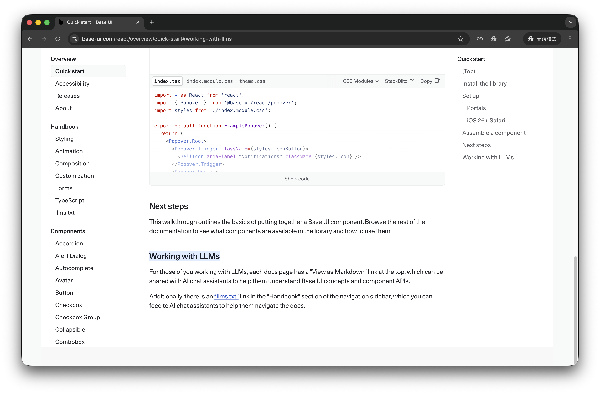

> 这次重搭个人主页，我原本只是想换一套更顺手的前端方案，最后却把 GitHub Actions 用成了内容更新工具。

## 搭主页不难，一直更新才麻烦

前段时间，我用 React、Vite 和 Base UI 重搭了个人主页，部署在 Vercel 上。最开始的要求只有三个：页面干净、结构清楚、部署简单。

页面做完以后，真正麻烦的是后续维护。博客发了新文章，主页的最近文章要跟着改；GitHub 上多了新项目，项目列表也要改。每次只改几行，但这种小事很容易一直拖。

所以这次我想顺手解决一个问题：主页仍然是静态站点，但文章和项目信息不用我手动同步。

## Base UI 的文档给了我一个启发

Base UI 除了常规文档，还提供了 [`llms.txt`](https://base-ui.com/llms.txt)。可以把文档的 Markdown 版本或 `llms.txt` 直接交给 AI 助手，让它更准确地理解组件和 API。



我后来整理主页内容时也用了类似的思路：先把数据整理成固定格式，再交给页面使用。不管数据来自博客还是 GitHub，前端拿到的都是同一种结构，不需要关心它们原来长什么样。

## 我把更新流程拆成了两层

一层是前台页面，也就是 React + Vite + Base UI；另一层是定时运行的内容更新脚本。

更新流程如下：

1. 从博客抓最近文章
2. 从 GitHub 抓最近公开仓库
3. 生成本地的 `data/content.ts`
4. 把变更提交回仓库
5. 由 Vercel 自动重新部署

这样，用户打开主页时，前端直接读取本地数据，不用再临时请求博客或 GitHub API。页面仍然是静态的，只是生成页面的数据会定时更新。

## GitHub Actions 负责跑这条流程

具体工作流放在 `.github/workflows/refresh-content.yml`，做的事情很直接：

1. 检出仓库
2. 安装 Node.js 22
3. 执行 `npm ci`
4. 运行 `npm run generate:content`
5. 只暂存 `data/content.ts`
6. 如果有变化，就自动提交并推送

它可以手动触发，也可以定时触发：

```yml
on:
  workflow_dispatch:
  schedule:
    - cron: '0 0 * * *'
```

Actions 提交之后，GitHub 仓库保存最新的 `content.ts`，Vercel 再根据新提交部署页面。整个流程不需要我登录服务器，也不用在本地记得运行脚本。

以前提到 Actions，我最先想到的是跑测试、构建和部署。这次发现，它也很适合接手个人项目里那些重复、规则明确的小事。事情本身不难，难的是每次都要记得做。

## 为什么不让前端直接请求接口

当然也可以让浏览器实时请求博客和 GitHub，但对这个主页来说没必要。

提前把数据生成到仓库里，有几个好处：

- 页面访问时不用等外部接口
- 不依赖博客和 GitHub API 当时的可用性
- 数据有提交记录，改错了容易查
- 本地开发和部署都只需要读取同一个文件

很多看起来需要实时更新的内容，其实每天刷新一次就够了。对这类需求，定时生成静态数据比再加一套动态服务省事得多。

## 同样的办法还能用在哪里

除了同步主页文章和项目，同样的办法还能用在这些地方：

- **定时整理内容**：同步书签、工具、订阅，生成榜单或文章索引
- **维护仓库展示内容**：更新 README 里的项目状态、更新记录、issue / release 信息
- **做轻量归档**：定期导出公开数据，保存配置或生成产物的快照

它们的共同点是不需要实时计算，更新规则又比较固定。交给人做很琐碎，交给脚本正合适。

这次重搭之后，我的主页还是静态站点，只是多了一条自动更新的内容链路。GitHub Actions 负责整理数据，仓库负责保存结果，Vercel 负责部署。我不需要经常照看它，这才是这套方案最省心的地方。

## 参考

- [ox0pine/ox0pine.top](https://github.com/ox0pine/ox0pine.top)
- [Base UI llms.txt](https://base-ui.com/llms.txt)
- [GitHub Actions 工作流语法文档](https://docs.github.com/en/actions/automating-your-workflow-with-github-actions/workflow-syntax-for-github-actions)
