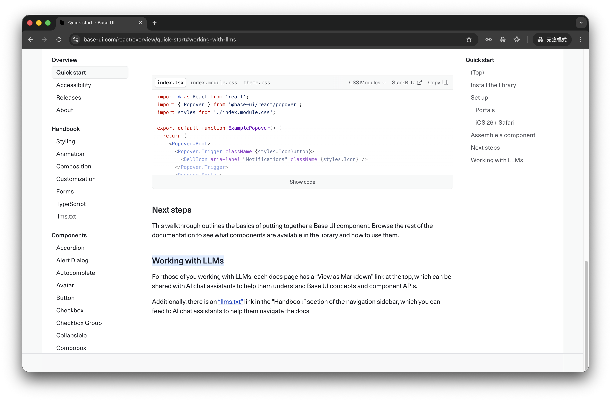

> 这次重新搭建个人主页，我原本只是想换一个更顺手的前端方案，最后却意外把 GitHub Actions 用成了网站背后的“内容编辑器”。

## 重新搭建主页时，我在想什么

前段时间，我把自己的个人主页重新搭了一遍。

一开始的目标其实很简单：页面干净一点，结构清楚一点，部署轻一点。于是我用 React、Vite 和 Base UI 重新把整个站点梳理了一遍，再挂到 Vercel 上，让它保持一个静态站点该有的轻盈。

但真正开始做之后，我很快发现，主页最难的地方从来不是“搭出来”，而是“养起来”。

页面本身可以很快上线，可一旦内容要靠手动维护，它就很容易停在某个时刻不再生长。写了新文章，要手动补最近文章；开了新仓库，要手动补项目展示。时间一长，主页就会变成一个样子还在、气息却慢慢淡下去的页面。

所以这次重搭主页时，我想解决的其实不是样式，而是更新方式：**能不能让它看起来是静态的，但内容是缓慢流动的。**

## Base UI 给我的一个小启发

这次重搭还有一个让我印象很深的地方，是 Base UI 对 LLM 的友好度。

它除了常规文档之外，还专门提供了 [`llms.txt`](https://base-ui.com/llms.txt)，官方也明确提到，可以把文档的 Markdown 版本或者 `llms.txt` 直接提供给 AI 助手，帮助模型更准确地理解组件和 API。



这个细节让我很有感触。因为它其实在做一件很现代的事：不是只考虑“人怎么读文档”，而是连“模型怎么理解文档”也一起考虑进去了。

某种程度上，我后来给主页做的内容链路，思路也是一样的：先把信息整理成稳定、结构化、容易消费的形式，再交给后面的系统去展示。

## 后来我把主页拆成了两部分

做到后面，我慢慢把整个主页理解成了两层：

1. **前台页面**：负责展示
2. **后台内容流**：负责更新

前台页面就是 React + Vite + Base UI。

后台内容流则是我后来补上的自动化链路：

- 从博客里抓最近文章
- 从 GitHub 抓最近公开仓库
- 生成本地的 `data/content.ts`
- 提交回仓库
- 让 Vercel 自动重新部署

这样一来，前端运行时不需要再去现场请求博客或者 GitHub API，而是直接读取已经生成好的本地数据。

我很喜欢这种方式。因为它保留了静态站点的简单，又让内容更新这件事变得不那么依赖人的勤快。

## GitHub Actions 在这里，像一个安静的内容编辑器

这个项目里，我最喜欢的部分其实是 `.github/workflows/refresh-content.yml`。

它做的事情并不复杂：

1. 检出仓库
2. 安装 Node.js 22
3. 执行 `npm ci`
4. 运行 `npm run generate:content`
5. 只暂存 `data/content.ts`
6. 如果有变化，就自动提交并推送

它支持手动触发，也支持定时触发：

```yml
on:
  workflow_dispatch:
  schedule:
    - cron: '0 0 * * *'
```

对我来说，这个工作流最妙的地方在于，它并不像传统 CI 那样强调“测试通过、构建完成、发布成功”，而更像一个很安静的编辑器，在背后定时帮我整理内容。

而 Vercel 又刚好接上了这一步：仓库一旦有新的提交，站点就自动重新部署。

于是整条链路就很顺了：

- GitHub Actions 负责更新内容
- GitHub 仓库负责保存结果
- Vercel 负责把最新页面上线

页面表面上很安静，但背后一直有一条自动化的水流在走。

## 这次重搭主页，反而让我重新认识了 GitHub Actions

以前我对 GitHub Actions 的理解比较朴素：跑测试、做构建、自动部署。

当然这些都没错，但这次做完之后，我更强烈地感觉到，GitHub Actions 真正有趣的地方，不只是它能替你“发布代码”，而是它能替你“处理那些重复、稳定、适合被机器接手的事情”。

把它放到个人项目里，这种感受会更明显。

因为个人项目最容易卡住的地方，往往不是技术难度，而是维护意志。很多事情不是不会做，而是懒得重复做。GitHub Actions 恰好就适合接这种活。

## 除了刷新主页内容，GitHub Actions 其实还能做很多事

这次做完主页之后，我反而开始觉得，GitHub Actions 在个人项目里的用法其实可以比 CI/CD 更宽一些。

### 1. 定时同步内容

这是我这次实际用到的一类。

只要某些数据来源是公开且稳定的，Actions 就很适合定时去抓取、清洗、生成本地数据，再交给静态站点渲染。

比如：

- 个人主页同步最近文章
- 作品集同步最近项目
- 导航页同步书签、工具或订阅内容
- 静态页面定时生成榜单、清单、摘要

这种用法的好处是，页面本身还是静态的，但内容不会完全停住。

### 2. 自动生成仓库里的展示内容

很多仓库里的 README、项目首页、徽章信息，其实都可以自动维护。

例如：

- 自动刷新 README 中的项目状态
- 自动生成最近更新记录
- 自动汇总 issue / release 信息
- 自动整理博客、视频、文章索引

这类事情人工也能做，但很容易拖。交给 Actions 之后，仓库会更像一个持续生长的对象，而不是写完就不再更新的代码堆。

### 3. 做一些轻量的数据备份和归档

个人项目里还有一类事情特别适合 Actions：周期性备份。

比如：

- 定时导出某些公开数据
- 定时备份配置文件或生成产物
- 定时把分散的信息汇总成一个仓库内可追踪的快照

它不一定要很重，也不一定非得是企业级备份系统。有时候只是把零散的数据定期沉淀下来，就已经很有价值了。

### 4. 让静态网站拥有一点“动态感”

我现在越来越喜欢的一种思路是：

**不要急着把网站做成一个实时请求一堆接口的动态系统，而是先看看能不能用 Actions 把动态信息提前烘焙成静态内容。**

这样做通常更简单，也更稳。

对个人网站尤其如此：

- 页面访问更快
- 外部依赖更少
- 部署更直接
- 出问题时更容易定位

很多看上去需要“动态”的需求，最后其实只要“每天更新一次”就够了。

## 写到这里，我反而觉得这像是一种网站观

这次重新搭主页，最后带给我的并不只是一个新的页面，而是一种更舒服的工作方式。

前端负责把页面铺开，GitHub Actions 负责把内容整理好，Vercel 负责把结果送到线上。每一层都不重，但组合起来之后，网站就有了持续更新的能力。

我越来越喜欢这种感觉：

- 页面是静的
- 内容是流动的
- 人只负责决定方向
- 机器负责处理重复劳动

如果以后我再用一句话概括这次重搭主页的收获，大概会是：

> GitHub Actions 最有意思的地方，不只是帮我部署网站，而是帮我照看网站背后那条持续流动的内容线。

## 参考

- [ox0pine/ox0pine.top](https://github.com/ox0pine/ox0pine.top)
- [Base UI llms.txt](https://base-ui.com/llms.txt)
- [GitHub Actions 工作流语法文档](https://docs.github.com/en/actions/automating-your-workflow-with-github-actions/workflow-syntax-for-github-actions)
